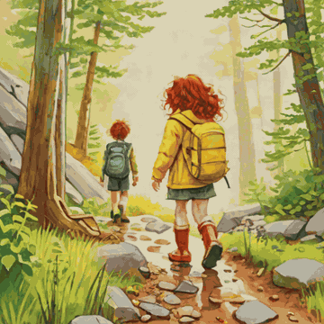
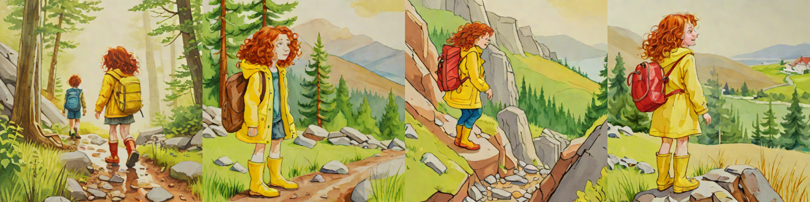

# AI Video Generator

Type a one-line story and get a narrated, illustrated short video, generated **entirely on a laptop** (M1 Mac, 16 GB RAM) with free, open tools.

```
"A girl finds a lost baby fox in the forest during a storm..."
        │
        ▼
 1. Scenes   Llama 3.1 8B (Ollama)   → 3–4 scenes as validated JSON
 2. Images   SDXL Turbo (M1 GPU)     → one storybook image per scene, same character
 3. Voice    Edge TTS                → narration MP3 per scene
 4. Video    FFmpeg                  → slow zoom + crossfades → MP4
 5. UI       Streamlit               → prompt box, progress bar, player, storyboard
```

**Result:** a ~15–22 second 1024×1024 MP4 in **about 1 minute**, with **$0 in API costs**.

### Sample output
A family's hike to a mountain summit, generated from a one-line prompt (preview below has no sound):



▶️ **[Download the full video with narration (MP4, 4.4 MB)](https://github.com/pradip818781/ai-video-generator/raw/main/docs/sample.mp4)**

The four generated scenes:



---

## Quick start

### Requirements
- macOS on Apple Silicon (tested on M1 Pro, 16 GB RAM)
- Python 3.13
- [Ollama](https://ollama.com) with the model pulled: `ollama pull llama3.1:8b`
- [FFmpeg](https://ffmpeg.org): `brew install ffmpeg`
- About 12 GB of free disk space (5 GB LLM + 6 GB image model)
- Internet for the first image-model download and for Edge TTS

### Install
```bash
python3 -m venv .venv
.venv/bin/pip install -r requirements.txt
```

### Download the image model (one time, about 6 GB)
```bash
HF_HUB_DISABLE_XET=1 .venv/bin/python -c "from huggingface_hub import snapshot_download; snapshot_download('stabilityai/sdxl-turbo', allow_patterns=['model_index.json','*/*.json','*/*.txt','*/*.fp16.safetensors'])"
```
`HF_HUB_DISABLE_XET=1` avoids a download failure seen on some networks (see [Troubleshooting](#troubleshooting)).

### Run the web app
```bash
.venv/bin/streamlit run app.py
```
Open http://localhost:8501, type a story idea, and click **Generate video**. Keep the Ollama app running.

### Or run each step from the terminal
```bash
.venv/bin/python scenes.py "Your story idea"   # → output/scenes.json
ollama stop llama3.1:8b                         # free RAM for the image model
HF_HUB_OFFLINE=1 .venv/bin/python images.py     # → output/images/scene_N.png
.venv/bin/python voice.py                       # → output/audio/scene_N.mp3
.venv/bin/python assemble.py                    # → output/video.mp4
```

---

## Project structure

| File | What it does |
|---|---|
| `scenes.py` | Sends the story to Ollama with a JSON schema, validates the reply with Pydantic (retries up to 3 times), and adds a fixed character description to every image prompt |
| `images.py` | Generates one 512×512 image per scene with SDXL Turbo on the Apple GPU (MPS): 4 steps, fixed seed, fixed art style |
| `voice.py` | Turns each narration line into speech (Edge TTS, `en-US-AriaNeural`) and measures clip lengths with ffprobe |
| `assemble.py` | Uses FFmpeg to make one clip per scene (Ken Burns zoom + narration with pauses), then joins them with crossfades |
| `app.py` | Streamlit UI: runs steps 1–4, shows progress, plays the video, offers a download, and shows the storyboard |
| `requirements.txt` | Python packages |
| `TOOLS.md` | Every tool and concept explained in technical and plain terms |
| `ROADMAP.md` | What's shipped and what's next |

---

## How it stays consistent

- **Structured output:** Ollama's `format` option takes a JSON Schema, so the LLM can only reply in that shape. Pydantic double-checks it.
- **Fixed character:** code (not the LLM) adds the same character description to every image prompt, so the wording never drifts.
- **Fixed style + seed:** one art-style phrase goes at the front of every prompt, and the same random seed is used for each scene. This fixed v1's mix of photo and cartoon images.
- **Prompt budget:** SDXL reads only 77 tokens, so style comes first and the character description is kept short (prompts are 65–68 tokens).
- **Memory:** the LLM is unloaded (`keep_alive: 0`) before the image model loads, so both never share 16 GB at once.

---

## Performance (M1 Pro, 16 GB)

| Step | Time per video |
|---|---|
| Scenes (Llama 3.1 8B) | ~22–27 s |
| Images (4 × SDXL Turbo, incl. model load) | ~17–22 s (about 3 s per image once loaded) |
| Voice (Edge TTS) | ~5 s |
| Video (FFmpeg) | ~8–10 s |
| **Total** | **~1 minute** |

---

## Cost per video

### Running locally (this project)
| Item | Cost |
|---|---|
| APIs and licences | $0 |
| Electricity (about 35 W for about 1 minute ≈ 0.0006 kWh) | ≈ $0.0001 per video (≈ ₹0.005) |

The power draw is an *approximate* whole-machine estimate, not a measurement. Hardware you already own is not counted.

### Same pipeline on paid cloud APIs (for quoting a hosted product)
Assumes per video: about 1,000 input + 1,000 output LLM tokens (measured: about 80–300 in, about 450 out), 4 images, and about 300 characters of narration (measured: 252).

| Step | Service | Price | Per video |
|---|---|---|---|
| Scenes | Claude Haiku 5.5 | $0.10 / $0.50 per 1M tokens (in/out) | $0.0006 |
| Scenes (higher quality) | Claude Sonnet 5.5 | $2 / $10 per 1M tokens | $0.012 |
| Images | Hosted SDXL / SDXL-Lightning (fal.ai, Replicate) | ~$0.002–0.0035 per image | $0.007–0.014 |
| Voice | Azure AI Speech, Neural TTS | ~$15 per 1M characters | $0.0045 |
| Video | FFmpeg on your own server | CPU only | ~$0 |
| **Total** | | | **≈ $0.01–0.03 per video** ($12–30 per 1,000) |

Notes:
- Claude prices are Anthropic's list prices as of November 2026. Image and TTS prices are third-party reports, not official price sheets, so check them before quoting.
- Edge TTS is free but is an unofficial interface to Microsoft's service. A commercial product should use the official Azure Speech API (priced above).
- **SDXL Turbo's licence is non-commercial.** For a paid product, use a commercially licensed model (e.g. SDXL-Lightning or SD 1.5) or a hosted API that includes commercial rights.
- Higher-quality image models (Flux, GPT-image class) cost more, up to about $0.04–0.20 per image, which would dominate the total.
- A hosted SaaS also pays for servers, storage and bandwidth, which aren't counted here.

Sources: [Claude pricing](https://platform.claude.com/docs/en/about-claude/pricing) · [fal.ai review 2026 (SDXL ≈ $0.0035/image)](https://aireiter.com/blog/fal-ai-review-2026) · [Replicate SDXL-Lightning 8-step (≈ $0.0018/run)](https://replicate.com/re-mix-1/sdxl-lightning-8step) · [Costbench: Microsoft Speech pricing ($15/1M chars)](https://costbench.com/software/ai-voice-tools/microsoft-speech/) · [Azure Speech pricing](https://azure.microsoft.com/en-gb/pricing/details/cognitive-services/speech-services/) · [Image API pricing overview](https://www.aimadetools.com/blog/ai-image-generation-api-pricing-2026/)

---

## Known limitations

- Small details can be missed or changed: the paper boat barely appeared in one story, and boots switched to red in one scene.
- Mood words like "storm" are often ignored by the 4-step Turbo model.
- Occasional glitches, such as a stray fox tail. Changing `SEED` in `images.py` usually fixes them.
- Single-user for now: everyone shares one output folder, so two simultaneous generations would overwrite each other (per-user jobs are on the [roadmap](ROADMAP.md)).
- Edge TTS needs internet. For fully offline use, swap in macOS `say` or Piper.

## Troubleshooting

| Problem | Fix |
|---|---|
| `localhost:8501` won't load | The app isn't running. Start it with `.venv/bin/streamlit run app.py` and keep that terminal open |
| "Ollama isn't running" | Open the Ollama app, or run `ollama serve` |
| Image-model download fails with `CAS Client Error` | Hugging Face's Xet transfer is blocked. Set `HF_HUB_DISABLE_XET=1` and retry |
| Slow or out of memory | Run `ollama stop llama3.1:8b` before the image step (the app does this automatically) |

## Roadmap
Vertical video for Shorts and Reels, subtitles, background music, style and voice presets, and cloud deployment. See [ROADMAP.md](ROADMAP.md).

## Licence
Copyright © 2026. All rights reserved. The source is published for viewing; contact the author for commercial use. Third-party models and tools keep their own licences (notably, SDXL Turbo is non-commercial).
